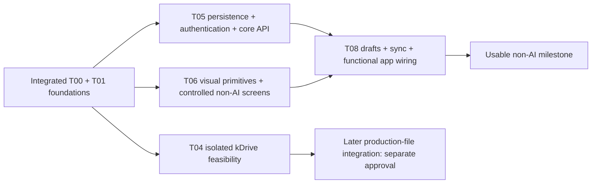

# Next implementation batch — usable non-AI app

Proposal only. No tasks or agents dispatched. Start from the integrated root baseline containing accepted C01 5cae797, C02 da223c3 and C03 a01e650, current T00, design/frozen-visual-spec.md and design/frozen-reel-detail-language-spec.md. Do not rerun their review cycle. Fix an integration regression only when actually observed.

## Outcome and dependencies

The next working milestone is: an allowlisted user signs in, sees Reel rows, captures text/URL/multiple images, edits script/hooks/metadata, and manages feed-cover completion and Publication fields. A local draft survives reload/network loss; retry does not create duplicates and stale saves preserve the draft. This is a runnable non-AI slice, not completion of every MVP feature.

Use the existing task roles and T00 boundaries. The retained task registry does not contain a separate full historical dependency-graph artifact; the graph below makes the dependencies of these proposed tasks explicit without inventing or renumbering other tasks.

After approval, T05 and T06 can start together. T04 may run independently when capacity and designated test access permit; its completion is not a prerequisite for capture/editing. T08 follows the T05/T06 interface handoffs, without waiting for Android/live Gemini/kDrive evidence. No automatic start unless that dependent task is itself explicitly approved. If slots are limited, prioritize T05/T06 and then T08 over T04.

## Interfaces and lead-owned decisions

- All domain data uses the current root wire contracts; SQL names stay snake_case. T05 exposes core HTTP routes under /api/v1; T08 owns the sole browser transport and session adapter. T06 never fetches or persists data.
- Proposed initial authentication: Supabase email/password sign-in for the two pre-provisioned, allowlisted accounts, no public signup or role-management screen. This is an explicit proposal for the non-AI milestone, subject to batch approval; it is not a change to equal NOXAVA/SZRON permissions. Do not create accounts, send invitations or alter hosted auth settings without authorization. If an existing approved sign-in setup is already available, use it and report its configured flow instead of replacing it.
- T05 owns token verification/allowlist enforcement and private app tables, including transactional operation deduplication and expectedVersion checks. No privileged browser key and no direct browser writes to app tables. Lightweight upload access is bounded and private; kDrive and Gemini never gate capture creation.
- T06 exports controlled `ReelListScreen`, `QuickAddScreen`, `ReelDetailScreen`, `PublicationSection` and shared primitives. Props carry render-ready state and callback intents, not an internal data store. Its proposed `ui/screen-contracts.ts` is reviewed by the lead before T08 consumes it. T08 owns controllers/adapters and translates wire responses into those props; it must not fork or weaken canonical wire types.
- T08 owns account-scoped IndexedDB drafts, operation IDs, sync queue and the functional root mount. Store unacknowledged data before network work; no false cloud-success message. Existing-Reel edits still conflict-check on reconnect. Do not implement a complete offline server replica.
- Lead alone owns canonical contracts, API composition in apps/api/src/app.ts, root dependency/lockfile reconciliation and cross-task integration. T05 exports `registerCoreRoutes(app, dependencies)` from its owned module for lead registration. Module-local dependency manifest changes are allowed only for their named task; root lockfile is reconciled once by the lead, avoiding concurrent edits.
- AI result workspaces, final prompts and unfinished UI remain outside this batch. Existing AI controls must not simulate a result or pretend a job ran; capability-disabled treatment is permitted for this partial milestone without redesigning their frozen placement. Shared meme-library management, programme ingestion/search and full production-file integration are later tasks, not hidden additions to these four.

## T05 — persistence, authentication and minimum non-AI API

1. **Task ID:** T05.
2. **Exact task:** Implement private Postgres schema/migrations, Supabase authentication verification and core repositories/routes needed for the milestone: /me, filtered/paginated list/detail, atomic capture with all image descriptors/initial hook, scalar patch, individual hook mutations, soft delete/restore, export reference/verification and bounded lightweight attachment initiate/complete. Include Publication fields/feedCoverDone and the published transition gate, separate immutable capture additionalText, mutable inputNote/editingNotes, server-owned scriptRevision and active/deleted list visibility with status-preserving restore. Store already-defined optional associations without implementing AI/programme/meme-library features. Provide reproducible local setup and fixtures for the two users.
3. **Exact model/agent:** Manual Opus 5, `claude-opus-5` as recorded in the prior manual handoff. This identifier is not verified by the Codex launcher and must be checked against the actual model selected in the user's Opus environment before execution. Not callable from Codex; user-selected manual handoff, no substitute. New isolated T05 worktree from the integrated baseline after approval.
4. **Why appropriate:** Database ownership, authorization and atomic mutation/idempotency boundaries are the most coupled work here; Opus can implement within the lead's frozen decisions and has the user's available capacity.
5. **Difficulty:** High, bounded to the non-AI core API.
6. **Dependencies:** Integrated scaffold, current T00, available local Postgres/Supabase or designated development project. No dependency on T04, T06, live Gemini or installed Android. Missing hosted credentials do not justify fake claims; local database integration tests can progress independently.
7. **Editable files/modules:** `supabase/**` for local config/migrations, `apps/api/src/core/**`, `apps/api/src/auth/**`, `apps/api/src/db/**`, `apps/api/src/core.test.ts`, `apps/api/package.json`, `docs/implementation/T05-result.md`. No app.ts/index.ts/shutdown changes, web code, shared contract source, worker, spikes or root lockfile. Propose any necessary additional config/env entries to the lead.
8. **Acceptance:** Migrations apply to a disposable database; unauthorized/expired/wrong-audience/unallowlisted access fails and both valid users can access shared Reels. Capture creates one Reel plus all pending supported images/initial hook atomically. Duplicate operation replay returns original result; changed payload with reused ID conflicts; concurrent expectedVersion writes cannot both overwrite. Cover false default and publish gate, independent export linking and selected-editor verification match T00. Individual hooks remain persistent and distinct. Script changes increment scriptRevision; metadata/hook-only changes do not. Editing-period timestamps obey entry/re-entry rules; editor/priority changes do not reset them. Deleted Reels are excluded by default and restore retains status; additionalText and original input provenance survive unchanged. Private upload completion is validated, not accepted solely on client assertion. Real database tests cover rollback/conflict/retry/auth boundaries; document any Supabase/Storage checks still blocked. No production migration/deployment. Return endpoint contract coverage and a scoped commit.

## T06 — visual primitives and controlled non-AI screens

1. **Task ID:** T06.
2. **Exact task:** Implement tokens, small reusable controls and controlled screen components for Rolki, Nowy pomysł, Reel Detail and inline PUBLIKACJA from the consolidated written visual specification. Include the newly frozen metadata sheets, inline Materials/source/editing-note sections, minimal delete confirmation and secondary deleted-list/restore presentation. Materials uses controlled export/verification/folder states and callback intents; unavailable backend capabilities stay honestly disabled. Include input/edit callbacks and empty/loading/offline/conflict presentation hooks; compose fixture-driven screens for development. No network, persistence or AI-result composition.
3. **Exact model/agent:** `gpt-5.6-luna`, new isolated T06 worktree after approval.
4. **Why appropriate:** Frozen styling and bounded presentational components fit Luna; data/concurrency strategy stays out of this task.
5. **Difficulty:** Medium.
6. **Dependencies:** Integrated React/Vite scaffold and written visual authority. Can start parallel with T05; no PNGs required. Its controlled prop/intents handoff precedes T08 wiring.
7. **Editable files/modules:** `apps/web/src/ui/**` (including tokens, screen-contracts.ts and screen components), `apps/web/src/screens/**`, `docs/implementation/T06-result.md`. No main.tsx, API/auth/IndexedDB/controller code, existing spike files, package/lockfiles or shared domain contracts. Use the existing typography stack and production-quality compact SVG icons; no new design exploration.
8. **Acceptance:** 360 px reference and 320 px reflow without page overflow; list selector may scroll horizontally. Dense rows/no chevrons, maximum two urgency signals, correct metadata prioritization and no verification state without export. Persistent hooks with per-hook removal intent; compact AI row stays nonfunctional for this milestone. Detail cover pictogram always available, inline completion/description/hashtags/publication links, one Kopiuj opis action. Exact frozen Material states/order, metadata option labels/null editor, original input versus additionalText/inputNote, shared multiline editingNotes and secondary Usunięte access with restore intent. Exact Polish labels, keyboard/focus and accessible names/targets; no cards, filled claim badges or invented unfinished screens. Validate visually at both widths using a local preview if available; report actual inspection, not screenshot assumptions. Props remain usable by real data; return scoped commit and component interface summary.

## T08 — drafts, synchronization and functional wiring

1. **Task ID:** T08.
2. **Exact task:** Implement the browser Supabase session adapter, typed core HTTP client, account-scoped drafts/blobs/operation queue and controllers wiring T05 to T06. Deliver sign-in/session recovery, list/detail navigation, capture/save, hook/scalar edits, metadata selection, original-input and note handling, delete/restore and Publication copy behavior. Wire existing export-reference/verification endpoints where available; kDrive creation remains disabled until later approved production integration. Reconnect creates safely; existing edits remain version-checked. Use the accepted share payload concepts to support quarantined pre-login capture input without claiming installed Android registration. Production Share Target/manifest rollout is not required for the manual-capture milestone.
3. **Exact model/agent:** `gpt-5.6-sol`, new isolated T08 worktree after approval.
4. **Why appropriate:** Sol can implement the bounded adapter/state-machine work against fixed contracts; the lead retains ownership of conflict/account-isolation decisions and integration.
5. **Difficulty:** High, focused on persistence and retry correctness.
6. **Dependencies:** T05 route/auth and upload handoff, T06 controlled screen interface, current draft/concurrency contracts. May start once those interfaces are handed off if separately approved; final acceptance requires their working implementations. Independent of kDrive/live Gemini/device gates.
7. **Editable files/modules:** `apps/web/src/data/**`, `apps/web/src/auth/**`, `apps/web/src/drafts/**`, `apps/web/src/controllers/**`, `apps/web/src/app/**`, `apps/web/src/main.tsx`, `apps/web/package.json`, `docs/implementation/T08-result.md`. No T06 ui/screens edits, root lockfile, shared contract source, API or spikes. Minimal login/session controls stay inside auth; do not design unfinished AI surfaces.
8. **Acceptance:** With configured development services, an allowlisted user can sign in, capture, reload, list/open/edit a Reel and save Publication fields. Multiple images retain stable IDs/blobs through upload retries. Account switch/logout cannot reveal another account's pending drafts; pre-login incoming shares remain quarantined until explicitly bound. Storage failure never reports saved; reload/offline recovery retains content; reconnect does not duplicate creates; 409 keeps draft and offers explicit recovery without silent overwrite. Queue stops on auth failure and resumes only for the correct account/session. Metadata selection closes only on successful mutation; failures preserve authoritative values. Cover gate, original/additional input separation, shared notes and status-preserving delete/restore follow the latest batch. API errors map to Polish. Kopiuj opis uses exact two-newline/empty-field rules without mutation and truthfully handles clipboard failure. Distinguish tests with doubles from actual browser IndexedDB evidence. Stop at scoped handoff; no deployment or AI execution.

## T04 — independent kDrive feasibility

1. **Task ID:** T04 (original kDrive spike, not the earlier C04 correction runthrough).
2. **Exact task:** Establish the minimal production-file reference/folder API behavior: permission model, deterministic create/lookup, duplicate or ambiguous creation recovery, missing/denied/transient outcomes, rename/move effects on stable identifiers. Use designated disposable resources only and produce a small diagnostic/report. No production-file uploader or product UI.
3. **Exact model/agent:** `gpt-5.6-sol`, new isolated T04 worktree after approval.
4. **Why appropriate:** A bounded API feasibility spike fits Sol; results inform later file integration without consuming Opus's core persistence capacity.
5. **Difficulty:** Medium; uncertainty lies in external access and API behavior.
6. **Dependencies:** T00 kDrive boundary, explicit test credentials/access and designated disposable folder for live mutations. Independent of T05/T06/T08. Without access, prepare contract/diagnostic and mark live behavior unverified; never block the non-AI milestone.
7. **Editable files/modules:** Only `spikes/kdrive/**`, including standalone diagnostic package, fixtures and report. No root dependency files, production references, other spikes or shared contracts.
8. **Acceptance:** Report exact provider endpoints/IDs/permission prerequisites; distinguish live from simulated evidence. Live checks, if authorized access exists, confirm create/lookup stability and error/ambiguous-create recovery within the disposable location. Never print credentials or mutate production data. No claim that a mocked response establishes kDrive feasibility. Return artifact/commit and explicit remaining gates.

## Open gates and stop rule

Installed Android Share Target, real browser concurrent IndexedDB promotion, credentialed/live Gemini and expanded unexecuted browser checks remain open. They do not block core non-AI implementation; no fixture/double becomes device/provider evidence. Actual new development-environment access is still required to claim the final app works against those services.

Each task hands back changed files, focused verification, limitations and its commit. The lead integrates disjoint outputs and performs normal integration checks, not another broad correction-review cycle. No agent may launch subagents, merge itself, provision paid infrastructure or dispatch the next batch. T16 and final editorial prompt work remain excluded.

## Reel Detail/Language Check delta scope

The new batch freezes Language Check and Meme picker/create interaction but does not authorize implementing them in T05/T06/T08. These tasks consume the non-AI Detail/source/notes/selectors/deleted-view deltas above; Meme library endpoints/UI, Language Check workspace/application and kDrive production integration remain later explicitly approved work. T05 maintains scriptRevision now so future language freshness does not require guessing historical edits. T06 may prepare shared bottom-sheet/text-action primitives without implementing AI results. All model selections and ownership restrictions above remain proposals.
